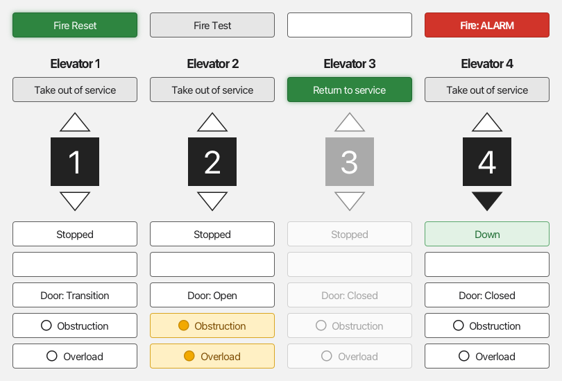
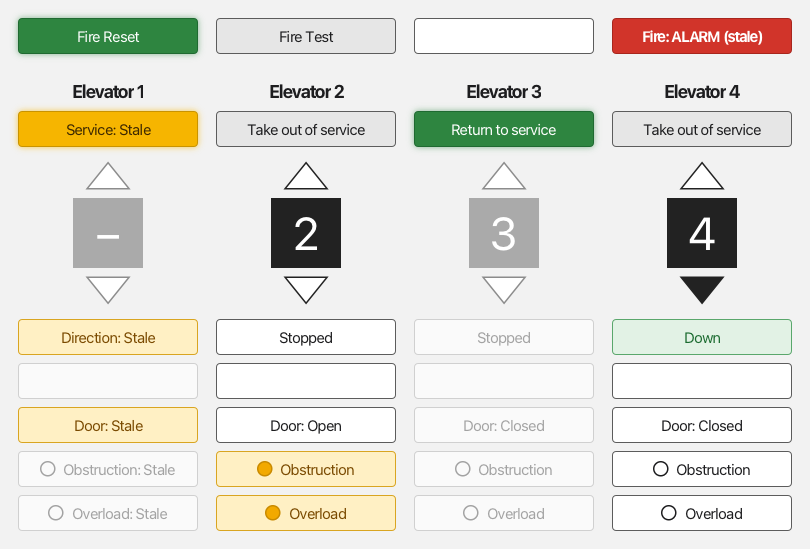

# Command Center integration status

23 November 2026

The panel and its separate Test1/Test2 harnesses use unchanged Team 3 sources
from commit `44402531af830541001fc74b478beeeb62c95def`. Our adapters read REGISTER
replies, use wildcard polling without duplicates, and restore subscriptions on
reconnect. The screen monitors four elevators serving five floors.

The panel starts with unknown values. Each cabin, door/warning, service, and
global fire source becomes stale after five seconds without valid telemetry.
Service buttons stay pending until the requested service state is reported.
An unconfirmed service request can be retried after 15 seconds or after stale
status recovers. Retry sends the same target state and does not claim completion.
Service controls are disabled when service status is unknown or stale. The
panel shows door transitions and retains fire alarms when their status is stale.

Checks passed: compile, vendor source/license checksums, local protocol and
controller checks, client reconnect, distributed fire/service updates, late
router startup, router restart, independent harness shutdown/restart, warnings,
stale sources, and JavaFX button/display checks. The original upstream bus
still prints exceptions when client sockets close.

These are illustrative panel states captured by the JavaFX check:

Remaining group agreements:

- ELEVATOR_COMMAND is defined as a command. Our harness also publishes it as
  confirmed service status. Agree on controller feedback before final integration.
- FIRE = 1 represents both a test and an alarm. Incoming active fire currently
  displays ALARM. Agree on the final indication and global status publisher.
- Confirm the five-floor project limit; the catalog accepts up to ten.
- Test the actual controllers across physical machines and record their final
  IP addresses, ports, results, and CCR/STS revisions. Those results are pending.

Router reconnection restores the link, but commands published while disconnected
are not retained. Reissue an unconfirmed operator command once communication
and fresh status return.
